

[中文](README.zh-CN.md) | [English](README.md) | [日本語](README.ja.md)

  
  
  

  
  

## ✨ 主な機能

- **ネイティブ描画** - UI は [MyGo](https://github.com/egoist/mygo) によってネイティブに描画され、軽量でなめらか。Windows、macOS、Linux に対応
- **ゲームカテゴリ管理とプレイ時間トラッキング** - カスタムカテゴリでライブラリを柔軟に整理し、ゲーム起動時にプレイ時間を自動記録
- **多次元統計** - 日/週/月/年などでプレイデータを集計し、統計カードをワンクリックで出力
- **AI 分析** - プレイデータを分析して、パーソナライズされた楽しいレポートを生成。MCP 公開と CLI skill にも対応し、データ活用シーンを広げます
- **便利なデータインポート** - Playnite、PotatoVN、Vnite、ReinaManager、YukiHub、Steam からの取り込み、フォルダ一括/ドラッグ＆ドロップに対応
- **バックアップと同期(beta)** - ローカルバックアップとマルチデバイス同期、AWS S3、七牛云、阿里云 OSS などの S3 互換ストレージ、および OneDrive、WebDAV、Umbra のクラウドバックアップに対応
- **CLI モード** - コマンドラインによるゲームの管理、起動、バックアップ、およびプログラムデータの修正に対応
- **プライバシーとセキュリティ** - 機密データはすべてローカルに保存

## 📷 スクリーンショット

カスタム背景スタイルをさらに表示

<table>
  <tr>
    <td width="50%" align="center">
      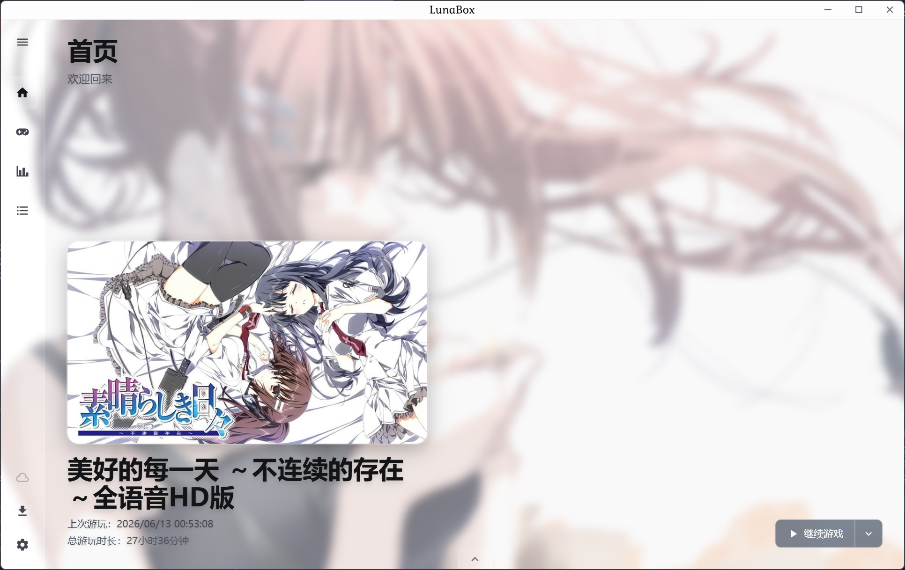
       
      ホーム
    </td>
    <td width="50%" align="center">
      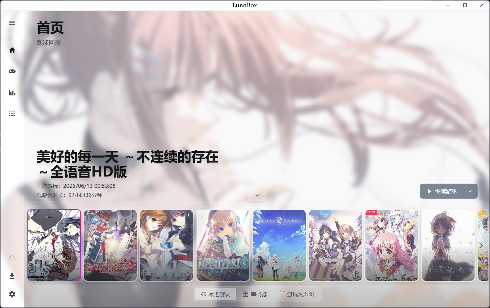
       
      別ホーム
    </td>
  </tr>
  <tr>
    <td width="50%" align="center">
      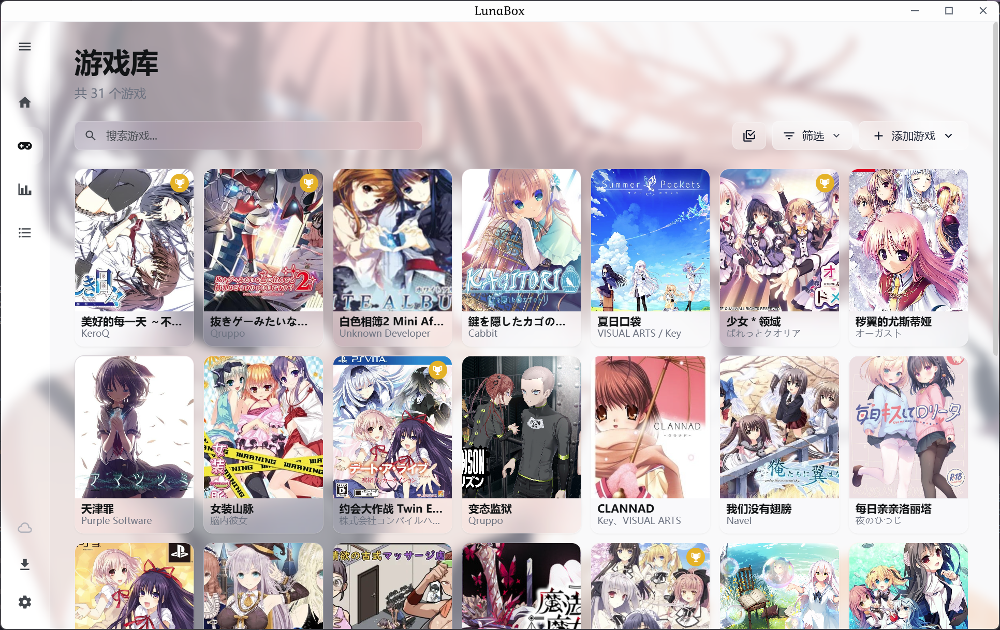
       
      ライブラリ
    </td>
    <td width="50%" align="center">
      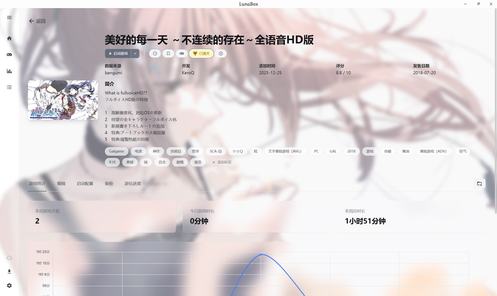
       
      ゲーム詳細
    </td>
  </tr>
  <tr>
    <td colspan="2" align="center">
      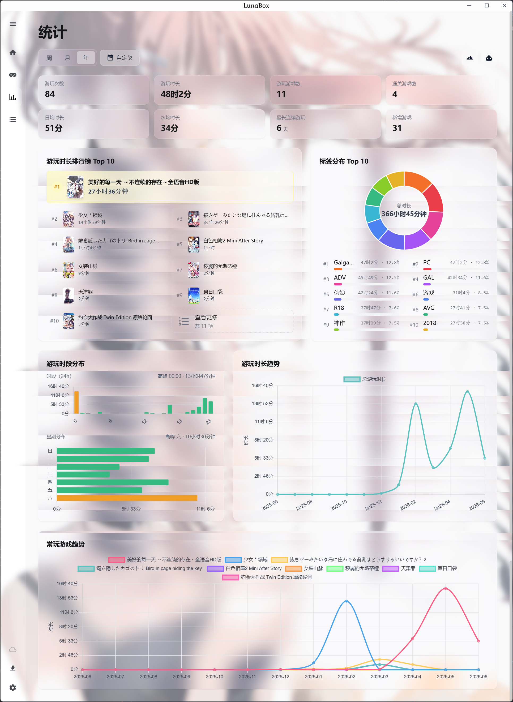
       
      統計
    </td>
  </tr>
</table>

統計エクスポート用ポスターテンプレートを表示

<table>
  <tr>
    <td width="33%" align="center">
      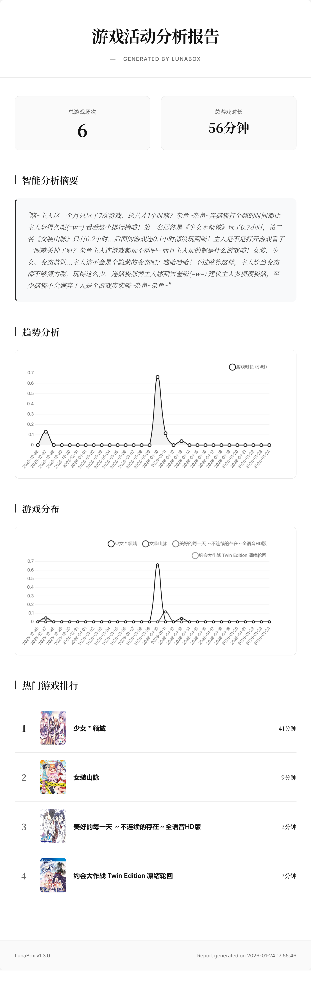
       
      ミニマル
    </td>
    <td width="33%" align="center">
      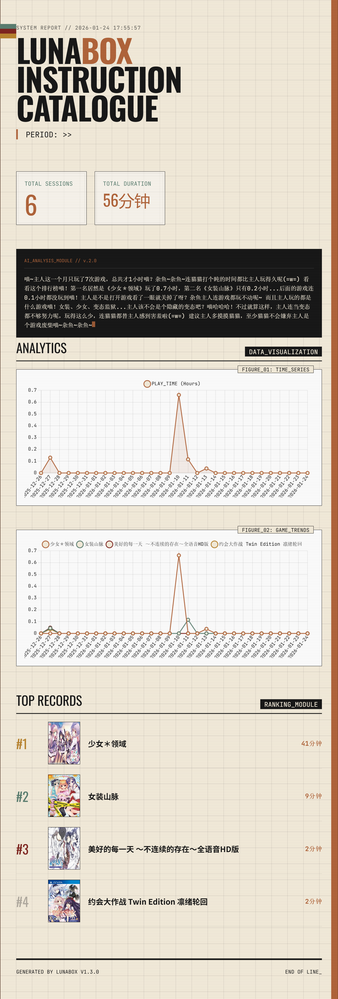
       
      フューチャーレトロ
    </td>
    <td width="33%" align="center">
      
       
      手帳風
    </td>
  </tr>
  <tr>
    <td width="33%" align="center">
      
       
      ポスター · 6 作品
    </td>
    <td width="33%" align="center">
      
       
      ポスター · 60 作品
    </td>
    <td width="33%" align="center">
      
       
      ポスター · 120 作品
    </td>
  </tr>
</table>

アプリ内スクリーンショット（リポジトリ内の `screenshot/` ディレクトリ）：

<table>
  <tr>
    <td width="50%" align="center">
      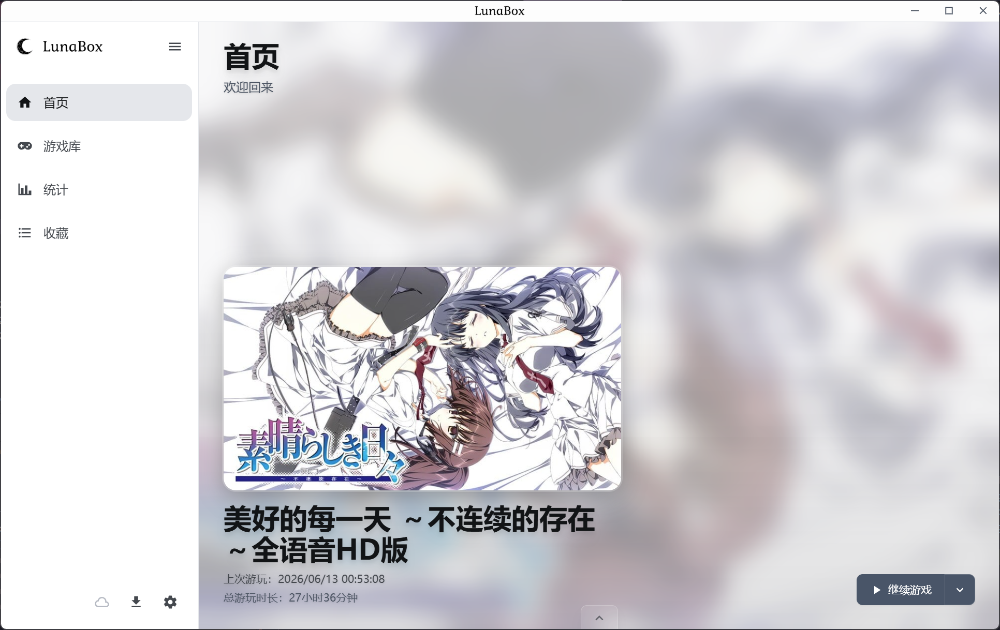
       
      ホーム
    </td>
    <td width="50%" align="center">
      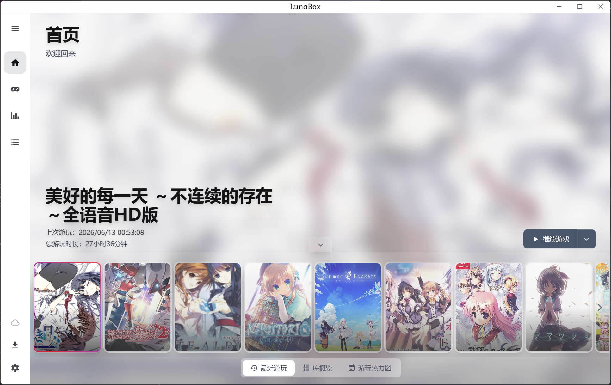
       
      別ホーム
    </td>
  </tr>
  <tr>
    <td width="50%" align="center">
      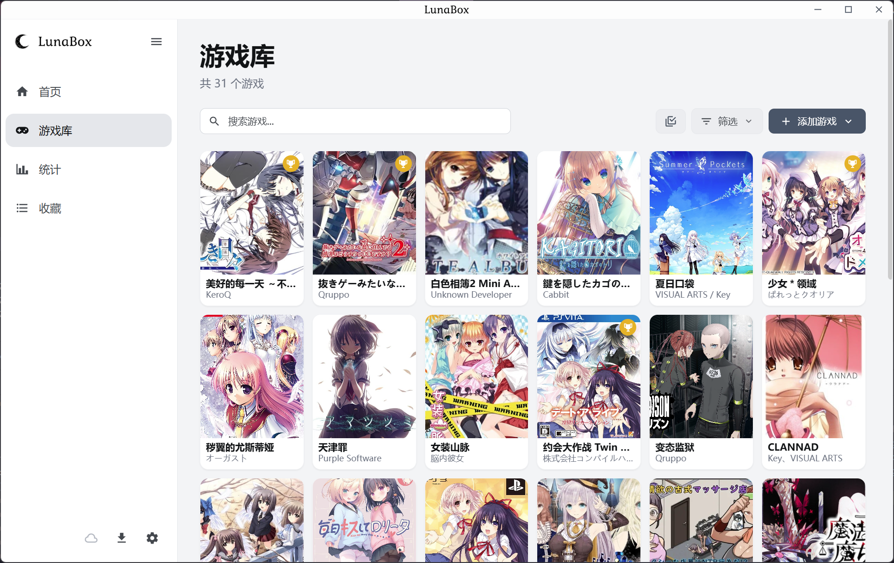
       
      ライブラリ
    </td>
    <td width="50%" align="center">
      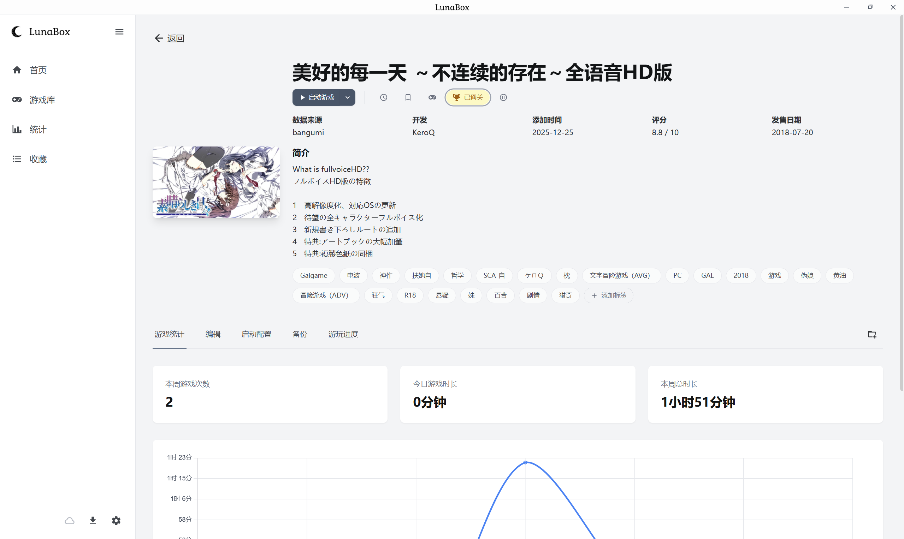
       
      ゲーム詳細
    </td>
  </tr>
  <tr>
    <td colspan="2" align="center">
      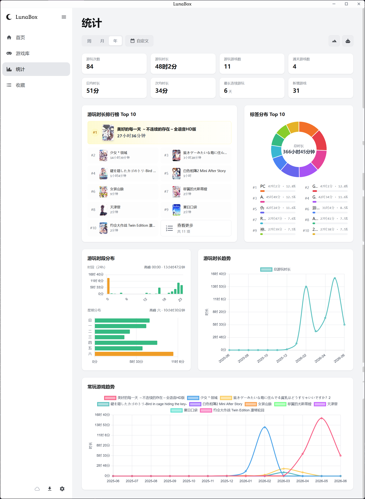
       
      統計
    </td>
  </tr>
</table>

## 📦 インストール

### Release からダウンロード

[Releases](https://github.com/Saramanda9988/LunaBox/releases) から最新版インストーラーをダウンロードしてください。

[AutoBuild](https://github.com/Saramanda9988/LunaBox/releases/tag/dev-latest) から Nightly ビルドをダウンロードして、最新機能を試すこともできます。

使い方や機能の説明は [LunaBox ドキュメント](https://box.lunarain.top)（中国語）をご覧ください。

## 🤝 コントリビューション

Issue と Pull Request を歓迎します！開発環境の構築、ローカルでの実行、パッケージングについては [開発ガイド](https://box.lunarain.top/guide/installation/)（中国語）を参照してください。

> [!IMPORTANT]
> v2.0.0 以降、LunaBox の UI は Wails v3 + React から MyGo に移行しました。旧 Wails 版のコードはタグ [`wails-final`](https://github.com/Saramanda9988/LunaBox/tree/wails-final) の `/apps/desktop` に残されています。

## 😀 オープンソースから、オープンソースへ

インスピレーション元：

- [PotatoVN](https://github.com/GoldenPotato137/PotatoVN) - Galgame 管理工具
- [ReinaManager](https://github.com/huoshen80/ReinaManager) - 一款轻量化的galgame和视觉小说管理工具
- [Playnite](https://github.com/JosefNemec/Playnite) - an open source video game library manager with one simple goal: To provide a unified interface for all of your games.
- [Vnite](https://github.com/ximu3/vnite) - A unified platform to organize your game collection, track gameplay, with real-time cloud sync across devices and detailed gameplay reports.

## 🙏 謝辞

ゲームメタデータ API 提供：

- [Bangumi](https://github.com/bangumi) - Bangumi番组计划
- [VNDB](https://vndb.org/) - The Visual Novel Database
- [月幕gal](https://www.ymgal.games/) - 请感受这绝妙的文艺体裁
- [萌娘百科](https://zh.moegirl.org.cn/) - 万物皆可萌的百科全书
- [Steam](https://store.steampowered.com/) - 世界最大のデジタルゲーム配信プラットフォーム
- [TouchGal](https://www.touchgal.ink/) - ワンストップの Galgame 文化コミュニティ
- [Hikarinagi](https://www.hikarinagi.org/) - あなたと仲間のための ACGN コミュニティ

解凍機能提供：

- [7-Zip](https://www.7-zip.org/) - A free and open-source file archiver, a utility used to place groups of files within compressed containers known as "archives".

## 🙌 スポンサー

|  | Windows 向けの無償コード署名は [SignPath.io](https://about.signpath.io/product/open-source) により提供され、証明書は [SignPath Foundation](https://signpath.org/) により提供されています。 |
| --- | --- |

## 📄 ライセンス

本プロジェクトは [AGPL v3](LICENSE) ライセンスで公開されています。

