

[中文](README.zh-CN.md) | [English](README.md) | [日本語](README.ja.md)

  
  
  

  
  

## ✨ 特性

- **原生渲染** - 界面由 [MyGo](https://github.com/egoist/mygo) 原生绘制，轻量流畅，支持 Windows、macOS、Linux
- **游戏分类管理与时长追踪** - 自定义分类，灵活管理游戏库，启动游戏自动追踪游玩时长
- **多维度统计** - 支持按日/周/月/年等多维度统计游玩数据，一键导出统计卡片分享保存
- **AI 分析** - AI 分析游玩数据，生成个性化趣味报告，支持mcp暴露与cli-skill能力，丰富数据使用场景
- **便捷的数据导入** - 支持从 Playnite、PotatoVN、Vnite、ReinaManager、YukiHub、Steam 中导入数据，支持选择文件夹批量导入/拖动导入游戏
- **备份与同步(beta)** - 支持本地备份与多端同步，AWS S3、七牛云、阿里云 OSS 等兼容 S3 协议的存储服务，以及 OneDrive、WebDAV、Umbra 云端备份
- **Cli模式** - 支持使用命令行管理，启动，备份游戏，修改程序数据
- **隐私与安全** - 所有敏感数据均保存在本地中

## 📷 截图

点击展开更多自定义背景样式

<table>
  <tr>
    <td width="50%" align="center">
      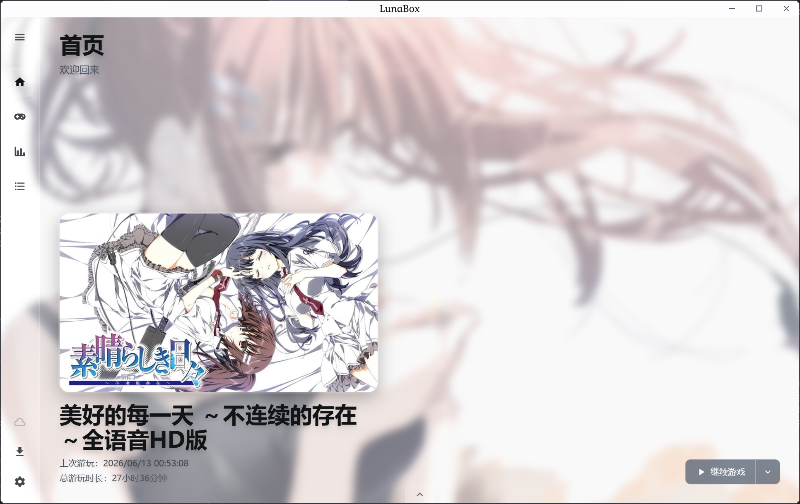
       
      主界面
    </td>
    <td width="50%" align="center">
      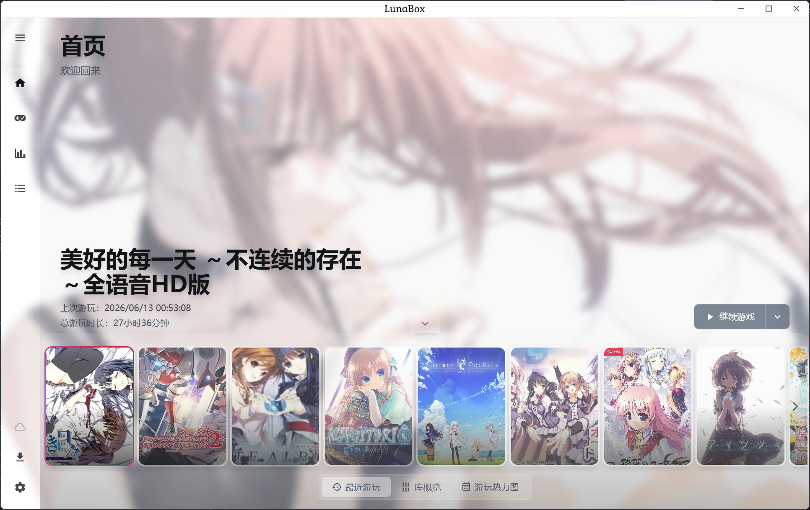
       
      主界面变体
    </td>
  </tr>
  <tr>
    <td width="50%" align="center">
      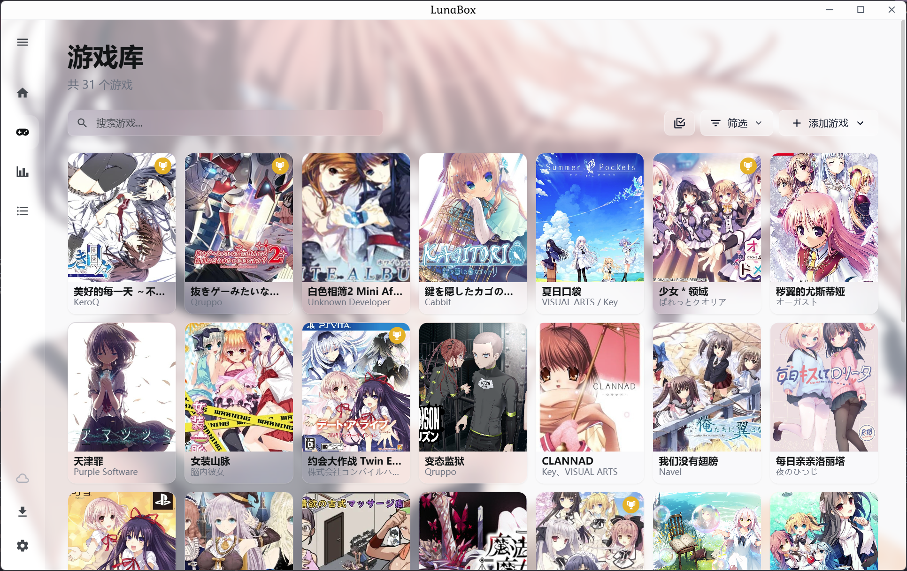
       
      库视图
    </td>
    <td width="50%" align="center">
      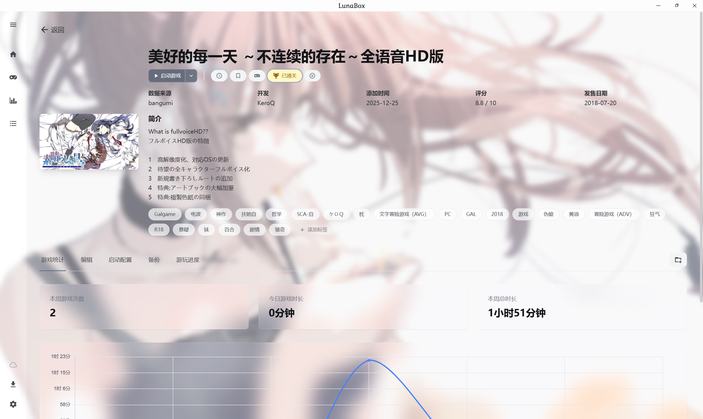
       
      游戏详情
    </td>
  </tr>
  <tr>
    <td colspan="2" align="center">
      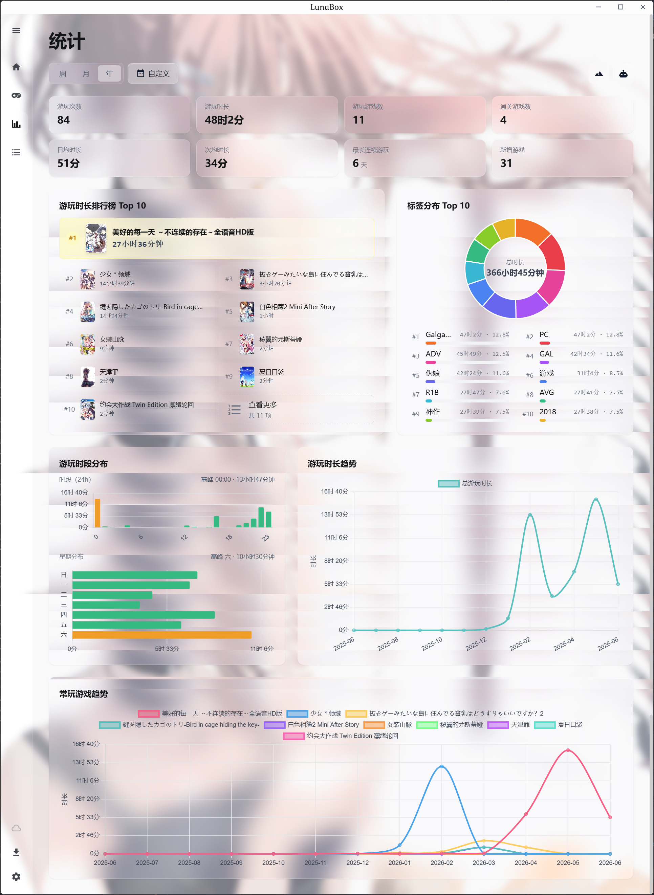
       
      统计视图
    </td>
  </tr>
</table>

点击查看统计导出海报模板

<table>
  <tr>
    <td width="33%" align="center">
      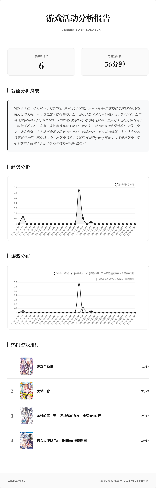
       
      简约
    </td>
    <td width="33%" align="center">
      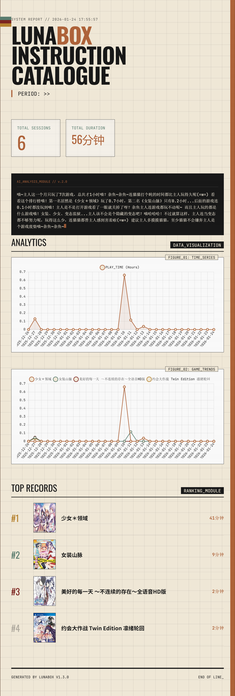
       
      未来复古
    </td>
    <td width="33%" align="center">
      
       
      手账风
    </td>
  </tr>
  <tr>
    <td width="33%" align="center">
      
       
      海报 · 6 个游戏
    </td>
    <td width="33%" align="center">
      
       
      海报 · 60 个游戏
    </td>
    <td width="33%" align="center">
      
       
      海报 · 120 个游戏
    </td>
  </tr>
</table>

应用中的部分截图（位于仓库的 `screenshot/` 目录）：

<table>
  <tr>
    <td width="50%" align="center">
      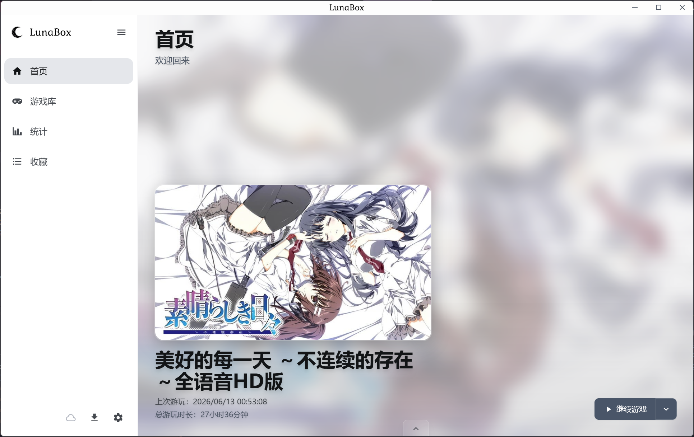
       
      主界面
    </td>
    <td width="50%" align="center">
      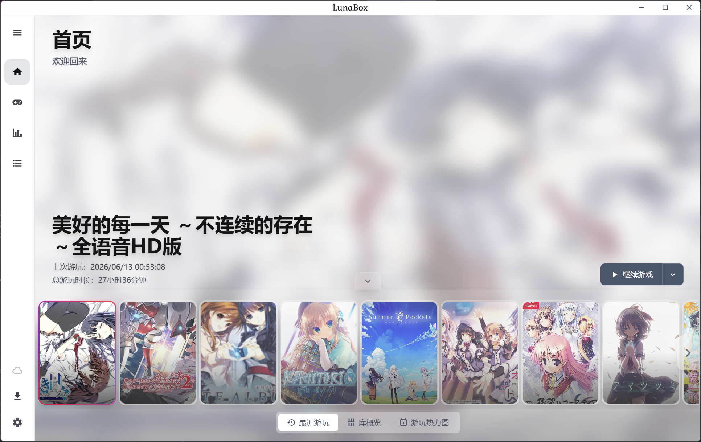
       
      主界面变体
    </td>
  </tr>
  <tr>
    <td width="50%" align="center">
      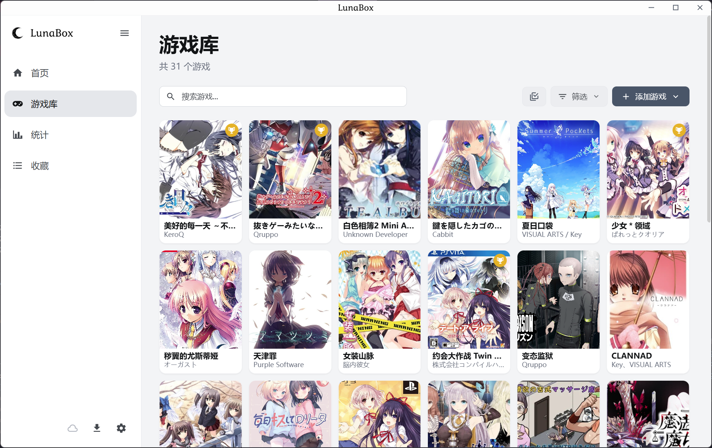
       
      库视图
    </td>
    <td width="50%" align="center">
      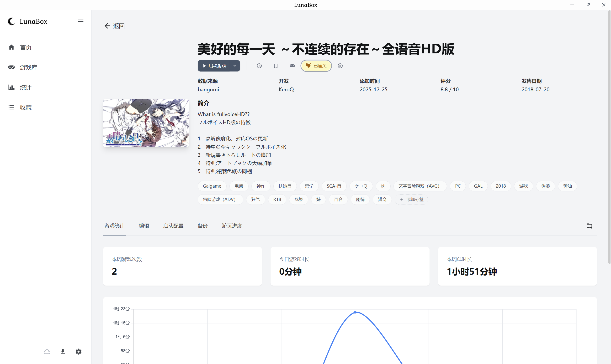
       
      游戏详情
    </td>
  </tr>
  <tr>
    <td colspan="2" align="center">
      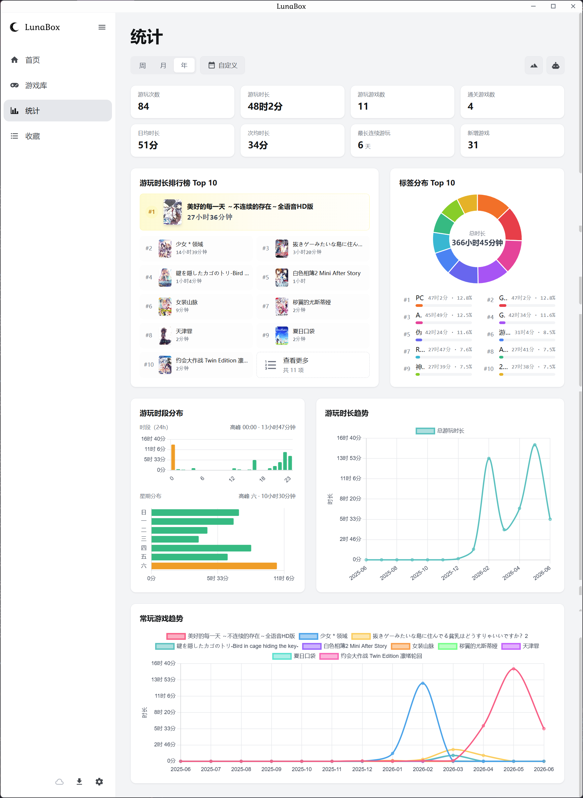
       
      统计视图
    </td>
  </tr>
</table>

## 📦 安装

### 从 Release 下载

前往 [Releases](https://github.com/Saramanda9988/LunaBox/releases) 页面下载最新版本的安装包。

您也可以在 [AutoBuild](https://github.com/Saramanda9988/LunaBox/releases/tag/dev-latest) 中下载 Nightly 版本，以体验最新的功能

使用教程与功能说明请查看 [LunaBox 文档](https://box.lunarain.top)。

## 🤝 贡献

欢迎提交 Issue 和 Pull Request！开发环境配置、本地运行与打包请参考 [开发指南](https://box.lunarain.top/guide/installation/)。

> [!IMPORTANT]
> 自 v2.0.0 起，LunaBox 的界面从 Wails v3 + React 迁移到 MyGo，原 Wails 版本的代码保留在标签 [`wails-final`](https://github.com/Saramanda9988/LunaBox/tree/wails-final)中的/apps/desktop中

## 😀 从开源到开源

灵感来源:

- [PotatoVN](https://github.com/GoldenPotato137/PotatoVN) - Galgame 管理工具
- [ReinaManager](https://github.com/huoshen80/ReinaManager) - 一款轻量化的galgame和视觉小说管理工具
- [Playnite](https://github.com/JosefNemec/Playnite) - an open source video game library manager with one simple goal: To provide a unified interface for all of your games.
- [Vnite](https://github.com/ximu3/vnite) - A unified platform to organize your game collection, track gameplay, with real-time cloud sync across devices and detailed gameplay reports.

## 🙏 感谢

游戏数据搜索api提供:

- [Bangumi](https://github.com/bangumi) - Bangumi番组计划
- [VNDB](https://vndb.org/) - The Visual Novel Database
- [月幕gal](https://www.ymgal.games/) - 请感受这绝妙的文艺体裁
- [萌娘百科](https://zh.moegirl.org.cn/) - 万物皆可萌的百科全书
- [Steam](https://store.steampowered.com/) - 全球最大的数字游戏发行平台
- [TouchGal](https://www.touchgal.ink/) - 一站式 Galgame 文化社区
- [Hikarinagi](https://www.hikarinagi.org/) - 你和同好的ACGN社区

解压功能提供:

- [7-Zip](https://www.7-zip.org/) - A free and open-source file archiver, a utility used to place groups of files within compressed containers known as "archives".

## 🙌 赞助商

|  | Windows 上的免费代码签名由 [SignPath.io](https://about.signpath.io/product/open-source) 提供，证书由 [SignPath Foundation](https://signpath.org/) 提供。 |
| --- | --- |

## 📄 开源协议

本项目采用 [AGPL v3](LICENSE) 协议开源。

